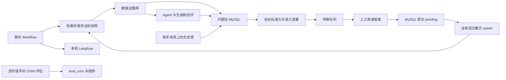

# Ch09 可观测性与数据飞轮设计

日期：2026-10-05；状态：修订设计已自查，待用户文档评审。实施计划与业务实现尚未开始。

## 1. 目标、范围与约束

让客服的一轮请求可追溯，让三个来源的知识问题经人工审核成为可检索知识，并以连续评估观察质量变化。

保留用户确定的技术：自托管 Langfuse、FastAPI、LangGraph/现有 SQLite checkpointer、MySQL 原文库、Milvus 原生 BM25+dense+RRF 与现有 reranker。方案 A 复用现有应用及 JobRunner，不新增消息队列或独立飞轮服务。Langfuse 使用独立本机 Compose；业务模型仍使用既有配置的服务商。

已确认：审核知识 category 固定为“用户问题补充”；每周一 02:00（Asia/Shanghai）全量评估；现有后台增加审核、趋势和意图 token 统计区域。前端按用户要求以 Vibe Coding 实施，不对前端套用 brainstorm/TDD/code review；本文件描述其必要业务契约。

置信度校准严格按配套实战文档执行：使用四信号加权，并先约束应拒样例误放率为 0%；在满足该约束的候选中选择误拦率最低的阈值。F1、F0.5、精确率和召回率只作为报告指标，不取代“误放率 0%”这一上线门槛。文档示例阈值 0.26 必须由当前模型、语料和评估数据实跑复现，不能直接写死。

不做主题微调分类器、跨会话画像、新业务工具、自动批准 AI 答案或跨机器分布式任务系统。

## 2. 架构与职责

新增职责边界：observability 管 trace/usage；flywheel 管快照、入池、归并与审核；evaluation 管校准、轮次和调度。API 只负责鉴权/参数校验与调用服务。数据库事务不跨 LLM 或 Milvus 网络请求。

## 3. DDL 与迁移

严格采用用户提供的 review_queue、eval_runs 及 low_confidence_questions 两列扩展，类型、默认值、索引、外键和中文注释保持一致。不额外新增业务表或列。

迁移顺序：SET NAMES utf8mb4 → review_queue → eval_runs → 问题池两列/索引/外键。迁移脚本支持 --check；按实际结构识别已完成项，对不兼容结构明确报错，不丢弃或重建原表。DDL 非事务回滚场景通过逐项检查支持中断后继续。

运行元数据使用已有 JSON/TEXT 和本地任务报告，不暗改 schema：

- 问题池 reason 保留人类可读原因；新记录使用固定事件标记首行及 JSON 元数据尾部，记录 schema_version、turn_id、resolved_question 和 reason_text。旧纯文本原因继续可读。
- eval_runs.metrics 包含稳定 run_id、各策略指标、真实分母、版本、报告路径标识和定时 slot；API 不接受任意文件路径。
- 审核来源通过 knowledge_chunks.section_path 的稳定值 `数据飞轮 / review_queue/{id}` 定位，不新增映射列。

## 4. Langfuse 接入与成本

### 4.1 部署和回调

独立 compose.langfuse.yaml 配置 Langfuse 及其 PostgreSQL、ClickHouse、Redis、对象存储依赖，使用独立卷/服务名；只对本机开放必要端口，关闭遥测。配置文件提供变量说明，不提交真实密钥。实现前用 Context7 确认并锁定兼容的服务端与 SDK 精确版本；部署 smoke 必须覆盖所用查询 API，不能假设服务端 v3 支持 Metrics API v2。

应用启动创建统一 callback，在编译后的图配置中绑定一次；不使用不存在的 compile(callbacks=...) 参数。保留原图的 checkpointer、aget_state、aupdate_state、astream 与 interrupt/resume 功能。每次执行上下文隔离，不能用共享可变字段存“当前会话”。

会话作为 session，turn_id 作为逻辑轮次身份。每次 HTTP 执行独立 trace，选单/工单 resume 与原轮次通过 turn_id、parent/request 标识关联，不让等待用户的时间冒充模型耗时。意图识别结束后补全该 trace 的实际 intent，并同步设置稳定 tag `intent:<意图>`；未识别成功使用 `intent:未识别`。

LangChain/LangGraph 回调记录节点和模型输入输出；HTTP embedding、rerank、Milvus 检索及统一工具引擎补子观察记录，包含来源、检索策略、完整 Top 片段、分数、重试、权限/校验拒绝和耗时。普通确定性节点记录输入输出，不能给它伪造 prompt 或 token 用量。

trace 不可用时聊天继续，上报使用有限超时和异步缓冲，关机有限时 flush；不能逐 token 同步写远端。验收必须查到真实存储的 trace 树，不能仅凭 callback 被调用判通过。

### 4.2 成本统计

按 trace 的最终 intent 归集该请求内所有模型调用，包括发生在意图识别之前的指代消解。只累加模型叶子 observations 的 usage，不再叠加父图的累计 token。输入、输出、总 token 和请求数分别展示；模型没有返回 usage 时显示缺失/估算标记，不算成零。离线评估、飞轮任务与线上客服分开统计。

成本页以 Langfuse intent tag 作为分组维度，从自托管 Langfuse 受支持的 Metrics API 查询并分页聚合；元数据用于追踪明细，不承担分组契约。实现前核实并锁定实际服务端版本支持的 tags 过滤和分组接口。采用时间范围限制和短缓存，失败显示暂不可用。没有模型价格配置就只报 token 和未知金额。观测以运行时回调为主，辅助脚本仅用于历史补标、诊断和验收核对，不能代替线上 trace。

## 5. 逐轮证据快照

在检索完成、清空弱证据或为 prompt 截短之前保存快照。内部逐轮快照保留 retrieval_id、query、strategy、时间、Top-K、chunk_id、section_path、question、完整 answer、原始 score、rerank_score、rank；多查询结果去重后保留查询来源。问题入池时从中截取相关性最高的 Top 3 原文与分数。按相关性 rank 保存，不使用首尾重排后的数组位置冒充排名。

快照作为最终助手消息的内部元数据进入现有持久化 checkpoint；固定兜底、直接回答、工具检索和售后子图都走统一收尾保存。内部元数据不能意外加入后续模型 prompt、工具 Schema 或普通历史 API；审核详情使用专用序列化。

问题池 retrieved_chunks 严格使用配套文档的三态语义，不增加外围状态包装：

| 情况 | 存储与展示 |
|---|---|
| 本轮未检索，或旧记录没有历史快照 | SQL NULL；页面区分提示“本轮未检索”或“历史无快照” |
| 成功检索零命中 | JSON `[]`；页面显示“已检索，零命中” |
| 有结果 | JSON 数组；保存 Top 3 原文、来源路径、原始分、精排分和排名 |

检索请求失败不是“成功检索零命中”，不能写成 `[]`。因用户负反馈确需落池时 retrieved_chunks 为 NULL，运行故障写入 reason 并进入 trace，页面显示“检索失败，无可用快照”。

👎 以 conversation_id、assistant_message_id 定位，不信任前端提交的原话或证据。后端检查会话所有权、助手消息身份及其 user 消息，通过 message_key/turn_id 查对应 checkpoint 元数据。必要时按该轮查历史 checkpoint；绝不使用最新一轮证据或重新检索生成“历史快照”。

## 6. 三个入池入口与生成顺序

1. retrieval_low_conf：成功完成的知识检索（含零命中）未通过校准闸，落池并兜底；闸仍在进入 Agent 之前。
2. self_check：数值闸通过后，对将实际交给生成模型的证据执行结构化 useful/reason 自评。覆盖强制检索、售后多查询及工具 FAQ 路径，useful=false 入池并在任何答案 token 发出前拒答。
3. user_feedback：用户对某条完成回答点 👎，按第 5 节保存其原话及证据，进入后续归并。

对同一 question+最终证据摘要 hash 缓存本轮自评结果；Agent 补充/改变证据时重新检查。纯闲聊、查订单等没有知识证据的回答不强行做知识自评。必须复用 Ch04 的判断契约，不能仅因现有 query_faq 含自评就认为其它路径已覆盖。

API/数据库/检索超时与限额是运行故障，记录日志和 trace，不能自动作为缺知识条目归并。用户对这类回答的 👎 仍按 user_feedback 保存，但处理器在调用模型前识别运行故障原因，暂不生成虚假的政策缺口。跳过原因按问题池 ID 记录在可恢复的本地任务报告中，重启后仍可查看；周期扫描不会对这种未归并行反复调用模型，人工处理后可显式重试。

### 入池幂等

自动入口事件键由 turn_id+source 生成；👎 由助手数据库消息 ID+source 生成。使用固定十六进制事件摘要作为 reason 首行标记。MySQL 连接级事件锁串行化同事件写入，在短事务中按 conversation/source/事件前缀复查，有则返回已有记录，无则插入；连接关闭释放锁。不是按原话去重，因为不同轮次相同问题应累计两次。

前端负反馈请求成功后才点亮锁定，失败可重试；成功响应丢失后重试返回同一条记录。👍 保持前端反馈行为。

## 7. 标准化、语义查重与待审队列

未归并问题由 matched_review_id IS NULL 驱动扫描，启动扫描和短周期扫描使用 JobRunner 中的固定任务入口。未完成行始终留在 MySQL，进程退出不丢任务。单条失败写有界重试记录并继续其它条目，避免一条坏数据长期阻塞整个队列。

使用本轮 resolved_question 补齐指代后脱敏；订单号/手机号替换为占位，但保留商品型号、否定和适用条件。无法消解的原话保留为待人工明确的问题，不让模型猜对象。原话始终原样保存在问题池。

飞轮单次结构化模型调用同时返回 normalized_question、ai_suggested_answer 和 matched_question_id；示例答案是待核准草稿，证据不足可明确标注需人工补全。查重候选覆盖 review_queue 全部状态：待审、通过、驳回。服务端验证返回 ID 确实在本批候选中；候选分批完整扫描，跨批有多个匹配时再核对，选择最早建立的等价项，不只截取前 N 条。

命中待审项时增加 occurrence_count 并归并原话；命中已通过或已驳回项时同样只增加 occurrence_count、回填 matched_review_id，原 review_status 和 approved_answer 保持不变，不自动复活、不新建重复缺口。没有任何等价项才创建新的待审行。

本章单机后台任务用专用 MySQL advisory lock 保证同一时刻只有一个归并任务；它持有独立连接但不跨网络请求保持事务。审核修改使用同一归并锁短时保护，拿不到返回忙状态。模型调用结束后开启短事务、锁原话行并复查未归并，再创建 review_queue 或 occurrence_count+=1，同时回填 matched_review_id；事务失败两项一起回滚。恢复重跑不会多计数。

## 8. 审核与当前检索索引

审核员确认/编辑 approved_answer 后点通过，AI 草稿不能绕过人工动作。核准答案非空且满足当前混合集合字段长度限制，不静默截断。

锁顺序固定为飞轮锁 → 现有知识写锁 → review_queue 行锁。共享同一 SQL 事务更新审核状态、保存核准答案并创建对应 KnowledgeChunk：category=用户问题补充、questions=normalized_question、answer=approved_answer、content_type=faq、section_path=数据飞轮 / review_queue/{id}、vectorize_status=pending。现有 importer 若自管事务，提取可加入调用方事务的底层写入方法，不能在两个独立事务间留下“已批准但没有原文”。

相同批准重复提交返回已有来源 chunk；改变已经通过的答案返回冲突，修订流程不在本章范围。驳回后不入库；并发的通过/驳回以行锁和预期状态处理，后到的冲突不能覆盖已完成审核。

提交 SQL 后，按 SQL 主键幂等 upsert 到 settings.milvus_collection 指定的当前混合集合，写入 dense、text 与所需元数据，BM25 由集合函数生成。成功确认后回填 vector_id/done；失败保留 pending，由补偿任务重跑。不能调用旧 kb-vectorize 写 knowledge，也不因一条新知识重建整个旧库。

SQL 提交后释放飞轮归并锁，网络索引阶段只保留知识写入所需互斥。启动及周期补偿扫描已批准 review_queue 对应来源路径的 pending chunk；即使在提交后、提交后台任务前崩溃，也能从数据库重新发现。该扫描不把历史遗留的其它 pending 原文误当成本章审核任务。

后台区分“已通过，待索引”和“已可检索”，向量成功但 SQL 确认丢失时安全重做 upsert。回复批准结果等待本次短索引尝试；超时转后台恢复，用户能看到真实状态。新增知识进入检索并通过证据闸/自评才是闭环完成。

固定分类是通用补充类别。本章默认聊天流程无显式 category 过滤，可检索它；明确指定其它分类的检索仍严格遵守该过滤，不擅自跨分类扩大范围。后台注明这一适用范围，验收包含默认聊天闭环及显式分类过滤不被绕过。

## 9. evidence_confidence 校准

### 标签与数据划分

复用 Ch04 全量问题、相关章节、答案要点和检索结果，增加逐题 evidence_sufficient 标注及理由。相关章节和字面覆盖用于辅助生成候选标签，边界、多事实、否定条件和库外题必须人工核对，不能直接用命中章节替代充分性标签。

按知识事实/商品与同义问题族分组划分校准、验证和独立测试，确保同一事实的改写不跨组。单查询与售后多查询都采集特征并分别报告结果。分组太少时补充标注用例，不退回会泄漏的随机逐题切分。

### 分数与选择规则

四个信号及固定权重与配套实战文档一致：Top1 rerank_score × 0.5、有效证据数 × 0.2、Top1-Top2 分差 × 0.2、关键条款命中 × 0.1。有效证据数按章节去重并归一到 Top-K，不将重复块当成独立证明；缺 Top2 时分差记为缺失并按冻结规则折算，关键条款命中只读取已有 `is_key_clause` 元数据。

各连续信号按冻结的校准规则归一到 0..1，加权结果命名 evidence_confidence，但明确它不是正确率概率。校准集采用配套文档约定的 60 条可答样例与 20 条应拒样例；按知识事实和同义问法族分组，避免同义改写跨集合泄漏。遍历候选阈值，先筛选应拒样例误放率为 0% 的候选，再选误拦率最低者；若仍并列，选择更高阈值。所有归一化参数、候选阈值和混淆结果写入报告。

上线目标是应拒样例误放率 0%，同时记录对应误拦率；配套文档中的预期示例是阈值 0.26、误拦率约 15%，实际结果以本仓库当前模型和语料实跑为准。独立测试集只做一次最终核验、不反复调参；要求无依据放行数为 0 且至少有真实充分证据被放行。若没有任何可用阈值满足门槛，本章此项不通过并保留报告，不能用全拒答伪装成功。

报告必须含最终阈值、四信号分值和权重、误放率、误拦率、F1/F0.5、精确率、召回率、混淆矩阵、库外误放行数、多事实结果、样本分母、数据集/知识语料/模型/Top-K/规则版本。没有命中直接拒答；无效分数按运行异常处理，不作为低置信知识缺口。

模型或 Top-K 不兼容时不启用旧校准，对需要该闸的请求返回服务配置异常兜底并记录运维错误，不将其自动归为知识缺口；业务数据类正常分流。新增知识不自动令整站拒答，标记语料版本变化并触发后续校准检查。每次审批新增答案另做闭环验证；自动更新校准参数须经过相同离线门槛，定期评估不会悄悄改线上阈值。

## 10. 定期评估与调度

### 完整轮次

复用 Ch04 评估器的四策略、300 题与指标定义，包括既有库外题排除/拒答率口径；保留每项真实分母。每轮生成独立 run_id 与 data/ch09/reports 下的报告，不能使用旧报告恢复机制将同一份已完成数据重复登记成两轮。

metrics JSON 包含 run_id、dataset_size、Recall@K 的 K、MRR、Faithfulness、拒答率、各策略/分桶结果、失败数、数据集/语料/模型/配置 hash、触发方式与定时 slot。趋势默认比较同数据集、模型与检索配置，语料改变标注部署点；数据集或指标口径变更断开曲线并显示版本。飞轮使库外题变成库内题时更新标注版本，不能继续拿旧标签判错。

失败/中断在独立轮次清单和日志显示，不进入完整成功趋势；不得排除失败题后把不完整分数显示成全量成功。忠实度原有个案台账规则继续保留。

### 周期、互斥与恢复

应用内增加最小周期调度器，JobRunner 只负责启动固定命令。Asia/Shanghai 每周一 02:00；本地运行清单原子写入 data/runtime/ch09，记录启用时间、定时 slot、run_id、状态、报告位置。首次启用只安排下一个时间点。

跨进程 MySQL advisory lock 保护任务启动/执行和运行清单更新；手动、自动、启动恢复共用同一评估互斥。多 worker 与服务重启不重复启动同轮。补跑最多一个最近错过的 slot，不累计所有历史周次；失败或已发起未完成的付费轮次标记待人工恢复，不因每次重启自动再次计费。应用未运行时任务不会执行。

完成后在专用结果锁内查询 eval_runs.metrics.run_id，存在则返回，否则插入一行并提交；查询和插入属于同一受保护事务。不依赖未定义的 UNIQUE 列。若结果已提交而文件状态未更新，重启按 run_id 识别已完成；报告存在但尚未入表可以只补入表，不重跑模型。

## 11. HTTP 与前端契约

| 入口 | 作用 |
|---|---|
| POST /api/chat/feedback | 负反馈；user_id、conversation_id、assistant_message_id；后端校验归属，成功返回稳定问题池 ID |
| GET /api/review-queue | 按状态分页，默认待审按次数降序、ID 稳定排序 |
| GET /api/review-queue/{id} | 标准问题、AI 草稿、原话明细、证据快照、审核与索引状态 |
| POST /api/review-queue/{id}/decision | 通过/驳回、核准答案、预期状态；冲突返回 409 |
| GET /api/eval-runs | 完整轮次与真实分母/版本，供趋势展示 |
| GET /api/observability/intent-usage | 有界时间范围的 Langfuse 意图 token 汇总 |
| /api/jobs 固定任务入口 | 飞轮处理、索引恢复、手动评估及运行状态，拒绝任意 argv |

沿用本机后台的访问范围，不声称新增用户登录或完整管理员权限体系。密钥不返回浏览器。审核列表、原话与片段按文本渲染，不能把模型/知识文本当 HTML 执行。

浏览器入口与配套文档一致：聊天页 `/`、待审队列 `/review`、观测与成本 `/observability`，Langfuse 默认本机端口为 `http://localhost:3000`。交付时提供 `make langfuse-up`、`make dev`、`make eval-flywheel` 这三个文档同名快捷命令；Windows 下同时给出等价的 PowerShell 命令，避免依赖用户必须安装 make。

聊天负反馈以服务端成功为锁定依据；后台修改核准答案后明确通过。原话详情显示快照缺失/零命中/有证据的差别。趋势图同时给出数值表；token 数与货币成本不混称。

审核页在列表顶部展示三道人工审核提示：垃圾或测试输入应驳回；活动等强时效问题原则上驳回；出现频次用于排优先级而非自动批准。AI 建议答案在通过弹窗中预填，审核员必须确认或修订后才能提交。已通过或驳回的问题再次出现时只更新次数，页面状态不自动回到待审。

## 12. 故障和资源边界

- LLM 标准化或查重失败：问题留池、未归并、可重试，不自动生成任意答案。
- MySQL 落池失败：客服可继续兜底，trace/日志明确记录失败；不能宣称已进入审核。
- Milvus/embedding 故障：审核原文保留 pending，不重复建知识。
- Langfuse 失败：不阻塞聊天；统计显示不可用，不能显示假零。
- 模型结构化输出非法：校验拒绝，本条留待重试，禁止把幻造 review ID 当归并目标。
- 同一任务网络重试有上限；报告及日志保留重试次数，不能自动无限消耗额度。

自托管 Langfuse 仍需要其 PostgreSQL/ClickHouse 等基础依赖；方案 A 的“不加数据库”仅指业务数据模型，不是说 Langfuse 不需要这些组件。

## 13. 验收与证据

1. 打开本机 Langfuse 的真实请求 trace，核对意图、子图、模型 prompt/usage、工具拒绝/成功、检索结果、耗时；并测并发会话不会串 trace，工单 resume 正常。
2. 库外题数值闸拒答入池、保留片段；强分但证据缺子问题的样例 self_check 拒答入池；服务故障不自动形成知识缺口。
3. 👎 对旧回答、刷新后回答、无检索回答分别验证归属与快照；重复 POST 只有一条记录，下一轮相同问题仍可另记。
4. 标准化同义原话归并计数；处理中断/重跑、审核与归并并发不重复计数。
5. 审核通过写入当前混合集合；重复批准不重复建知识；在 upsert 后 SQL 确认前故意中断可补齐；重问得到核准答案和正确引用。
6. 校准报告展示四信号固定权重，使用 60 条可答与 20 条应拒样例扫阈值；核查最终误放率为 0，并报告实际阈值与误拦率，避免全拒答蒙混。
7. 两轮实际独立的全量真实评估入表且有趋势；失败/恢复不重复入表；时钟驱动测试周一触发、错过一轮、多进程互斥及手动冲突，不等一星期测试调度。
8. 意图 token 统计与抽样 trace 的模型 usage 相加一致，离线评估不混入线上统计。

后端可测代码走 TDD；Prompt/标注/阈值用冻结样例与评估集验证；前端按用户指定方式做浏览器交互验收。完成时交付启动/演示命令、测试结果、真实 trace/评估报告和 dev-notes/ch09.md。真实 API 验收数据范围在执行前明确，不以先前其它章节授权代替本章所需授权。

## 14. 自查结果与下一步

已对照审查记录和《9.2 实战演练：动手实现飞轮闭环》逐项覆盖：当前集合、自评路径、拦截前快照、逐轮反馈、事务幂等、全状态查重、四信号校准、调度恢复、Langfuse intent tags 与 token 口径；没有更改用户 DDL。保留现有分类过滤语义，并明确固定补充分类的适用范围。F0.5 仅为报告指标；尚未跑出或宣称阈值 0.26 等任何校准数值。

技术资料已通过 Context7 查询 LangGraph 与 Langfuse。实现前按各任务核对 SQLAlchemy、FastAPI、Milvus 和所锁定 Langfuse 版本的具体 API。本文获批后再调用 writing-plans 编制可执行任务计划；当前不安装依赖、不执行迁移、不启动新的聊天服务。

参考：
- 审查记录：docs/superpowers/reviews/2026-10-05-ch09-design-review.md
- https://github.com/langchain-ai/langgraph/blob/main/pregel/main.py
- https://langfuse.com/docs/metrics/features/metrics-api
