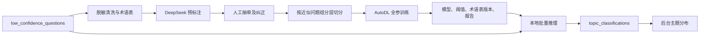

# Ch10 多标签主题分类器设计

日期：2026-10-11；状态：设计定稿，待用户书面评审。

## 目标与边界

把第九章 `low_confidence_questions` 积累的问题按主题批量归类，帮助审核人员判断先补哪类知识。分类器只在旁路离线任务使用，不参与实时客服、意图识别或知识检索。采用 `hfl/chinese-roberta-wwm-ext` 全参数微调；AutoDL GPU 负责训练，本地下载后的 Transformers 模型负责定期批量推理。不得自行改用 LoRA、其他底座或在线分类服务。

用户已同意：真实问题脱敏后发送给 DeepSeek 预标注，并上传 AutoDL 训练。未脱敏原话、会话身份、手机号等个人信息不得进入外部请求或训练包。AutoDL 实例的租用和收费步骤须以实际规格、预计费用及可复核命令呈现；模型与报告下载并核验后停止实例。

## 组件与数据流

数据准备、训练、评测、批量推理是可独立重跑的命令。训练产物包含 checkpoint、tokenizer、17 标签次序、逐类阈值、底座修订号、数据清单哈希和训练配置；缺一项或版本不匹配时本地推理拒绝运行，避免标签错位。运行日志不打印原始问题、密钥或完整训练包。

## 17 类权威术语表与标注

在仓库中只维护一份带版本号的机器可读术语表，数据准备、LLM 提示词、训练、推理和页面共用。标签依次为：退换货、物流、尺码、发票、质量问题、运费、优惠活动、价保、支付、订单修改、库存补货、商品信息、保修维修、账号、会员积分、评价、其他。每类写一句边界说明和正反例；至少固定这些界线：修理归保修维修，退货归退换货；运费管钱，物流管货；价保是补差价，优惠活动是券和满减。

按用户句面明确表达的诉求标多个标签，不从情绪或背景推断隐含诉求。例如“买大了想退”是尺码加退换货；“其他”仅在前 16 类均不适用时单独出现。DeepSeek 按术语表返回严格 JSON 标签数组；越界标签、空数组和与“其他”并列的结果进入复核，不自动放行。人工按类别及来源分层抽审，抽审发现系统性错误须修订边界或预标提示并重标受影响批次；保留原预测、人工修订和术语表版本以供审计。自动标注不能冒充人工真值。

## 数据准备和切分

从问题池读取真实问题及其 ID，先清洗格式、常见错字并脱敏手机号、地址、姓名、订单号等可识别信息；保留问题的主题信号，脱敏不确定的行转人工处理或排除。用于外部标注与 AutoDL 的文件只含脱敏文本、匿名样本 ID、来源类型、标签，不含原数据库 ID 与会话 ID；匿名 ID 到数据库 ID 的映射只留本地受忽略目录。

真实问题不足时，用大模型照术语表生成补充问题，标记 `synthetic` 并人工抽审。先对清洗后相同或近似的**真实问法**建立组，再按真实样本 80/10/10 目标做多标签分层切分，同组只能落入同一份；稀有标签或组大小使精确比例不可同时满足时，优先保证不泄漏并报告实际比例。模拟样本和同义替换、句式微调后的样本只进训练集，因此加样后的训练文件会超过真实样本的 80%，报告同时列出切分前后的分布。增强只在切分之后执行。验证与测试使用真实且经人工确认的样本；若实际真实样本不足以让某类在验证或测试中出现，报告该类样本数及“不可评估”，不能用合成样本伪造真实指标，也不能宣称该类达标。冻结种子、组映射、各份样本 ID、标签分布及数据哈希，测试集在阈值选择和早停阶段保持封存。

## 训练、评测和模型选择

AutoDL 上安装经文档核对并锁定的 PyTorch/Transformers 依赖，使用指定底座的 `AutoModelForSequenceClassification`、`problem_type=multi_label_classification` 和 17 个输出，全参数更新，BCEWithLogitsLoss；不冻结底座层。使用验证集监控 macro F1 与验证损失，加入 weight decay、dropout、固定随机种子和 early stopping，并只保存最佳权重。学习率、批量大小、最大长度、梯度累积和 epoch 上限写入训练配置与报告；实例显存不足时先调批量与累积，不改变模型或微调方式。

在验证集上逐类校准 sigmoid 阈值并冻结，不能在测试集上挑阈值。最终在一次封存测试集上报告每类 TP/FP/FN/TN、precision、recall、F1 和 2×2 混淆矩阵，另报 micro/macro 指标、各类真实样本数、真实与模拟训练样本数。人工抽看错误样本并记录错误类型，至少覆盖近邻边界及多标签句。性能指标没有预先拍定的数值门槛；若某类没有足够真实测试样本，验收只证明链路可运行，不宣称模型质量已被充分验证。

## 数据库与旁路推理

严格采用用户给出的 `topic_classifications` DDL：`id BIGINT UNSIGNED` 自增主键，`question_id BIGINT UNSIGNED NOT NULL` 唯一且外键指向 `low_confidence_questions.id`，`labels JSON NOT NULL`，`classified_at DATETIME NOT NULL DEFAULT CURRENT_TIMESTAMP`，InnoDB/utf8mb4。SQLAlchemy 模型字段、唯一键、外键、默认值和注释与 DDL 对齐。迁移脚本先核对依赖表及已有结构，`SET NAMES utf8mb4` 后建表；重复执行只在结构一致时通过，不删改已有问题。

本地批量任务只读取尚未归类或显式请求重归类的问题，脱敏后送入本地模型，不向 DeepSeek/AutoDL 发在线请求。预测标签通过术语表校验；若 16 个业务类均低于阈值，输出单独的“其他”。按 `question_id` 幂等 upsert：正常重跑不重复插行，显式重归类可更新 `labels` 与 `classified_at`。任务采用现有 `JobRunner` 固定命令，记录模型哈希、处理数、跳过数和错误数；数据库失败可重跑。模型加载、CPU 内存占用和批量大小以实测决定，不让实时聊天进程加载模型。

## 后台页面

在现有飞轮后台增加主题分布入口，按 17 类显示问题数量；多标签问题分别计入命中的每一类，页面说明各类之和可能大于已归类问题总数。展示总问题数、已归类数、最近归类时间、当前模型版本及任务状态；可触发固定批量任务。前端按用户要求用 Vibe Coding 直接实现，复用现有原生 HTML/CSS/JS 与后台导航，不套前端 brainstorm/TDD/code review。后端仅提供只读统计和固定任务入口，不允许浏览器上传任意模型路径或 SQL。

## 故障与验收

DeepSeek 返回无效 JSON、脱敏不确定、真实数据不足、AutoDL 中断、模型产物不完整、数据库暂不可用都应显式失败或跳过并留下可复核记录；不自动把未知标签强行转成已知类。训练脚本支持从已保存的最佳 checkpoint 恢复；数据准备和批量推理均可重跑。断点恢复不得改变冻结测试集。

验收依次检查：迁移结构与 DDL 一致；17 类术语表边界与多标签样例正确；评测报告确有每类 F1 与混淆矩阵并标真实样本分母；“买大了想退”能同时命中尺码、退换货；一批真实问题经本地推理写表并在后台图表可见；聊天主链路无分类器调用。AutoDL 上的真实训练结果、费用和耗时以实际运行记录为准，设计文档不预称已训练成功。
